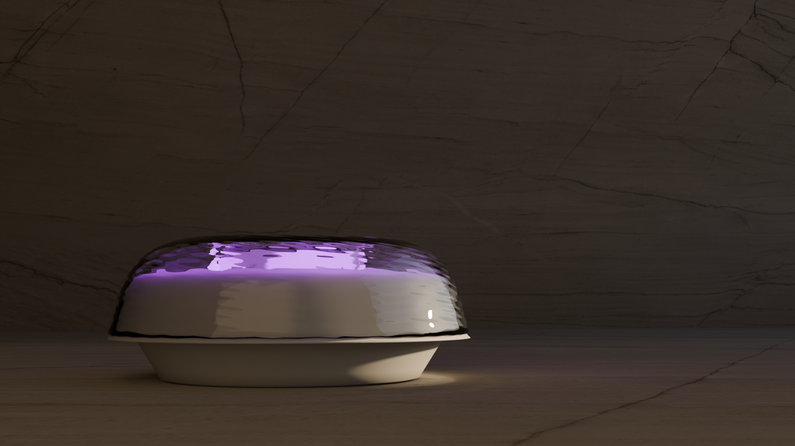

# UFI: UV Functional Identification System

## Overview

The UFI (UV Functional Identification System) is an engineered, lightweight optoelectronic device designed for functional verification and identification tasks utilizing ultraviolet radiation. The device integrates dedicated optical components, onboard driving circuitry, and a custom enclosure engineered for ergonomic handling and mechanical reliability.

## Key Features

- Optoelectronic core: UV emission architecture designed for target functional inspection and identification.
- Compact form factor: Lightweight, portable construction optimized for hand-held field operation.
- Custom enclosure: Tailored mechanical packaging designed to protect internal electronics and maintain proper thermal characteristics.
- Optical alignment: Dedicated front assembly ensuring appropriate emission focus and minimal stray radiation.

## Industrial and Mechanical Design

The mechanical enclosure and visual marketing assets were designed and developed by Aleksandra Miechowicz. The mechanical design balances compact dimensions, structural rigidity, and assembly ergonomics.

Contact to Mechanical Design & 3D Visualization designer: [Aleksandra@miechowicz.pl](mailto:Aleksandra@miechowicz.pl)

## CAD Visualizations and Renderings

### Illumination Configurations and Side Profile

  
  

### Structural Breakdown and Exploded Assembly

  
  

### Isometric and Perspective Renders

  
  

## Project Structure

- UFIdiffrentlightsettings.png: Lighting and emission state visualization.
- UFIleftside.png: Lateral enclosure perspective view.
- UFIviolettransparent.png: Material transparency and ray visualization.
- blowupUFI.png: Exploded CAD view detailing individual enclosure components.
- ufi3.png: Perspective isometric rendering of the assembled device.
- ufi4.png: Secondary operational rendering.

## Credits and Contact

- System architecture and electronics: Sidowsky
- Mechanical design and 3D visualization: Aleksandra Miechowicz (Aleksandra@miechowicz.pl)
