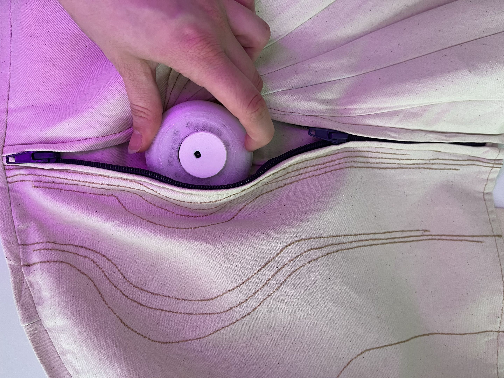
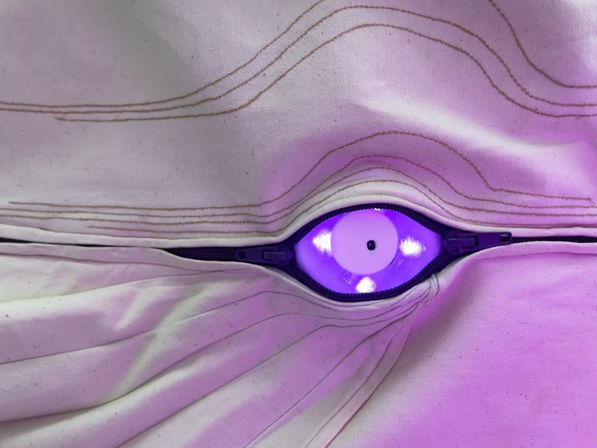
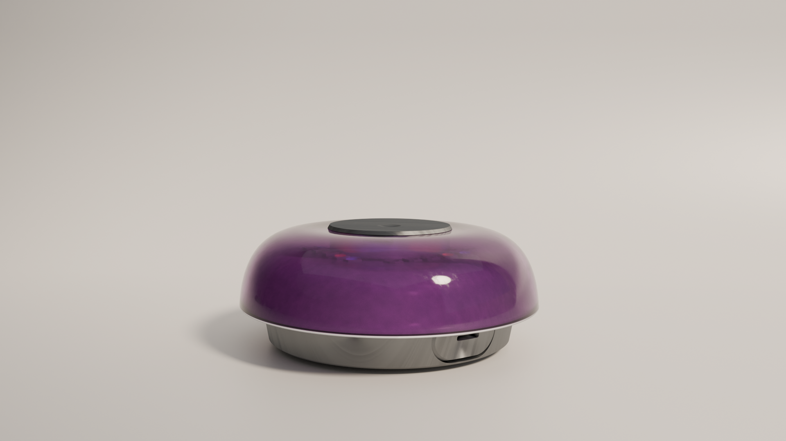
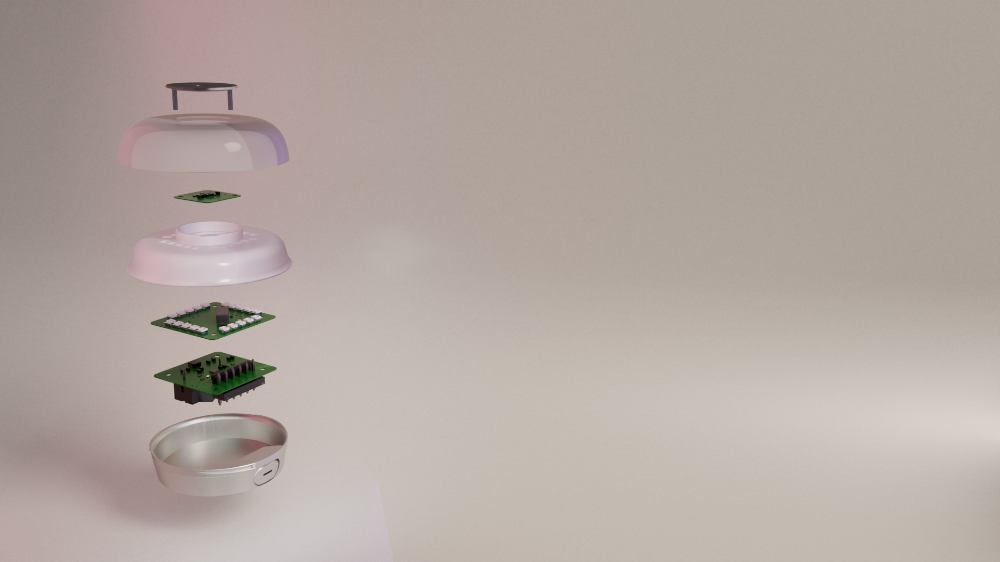
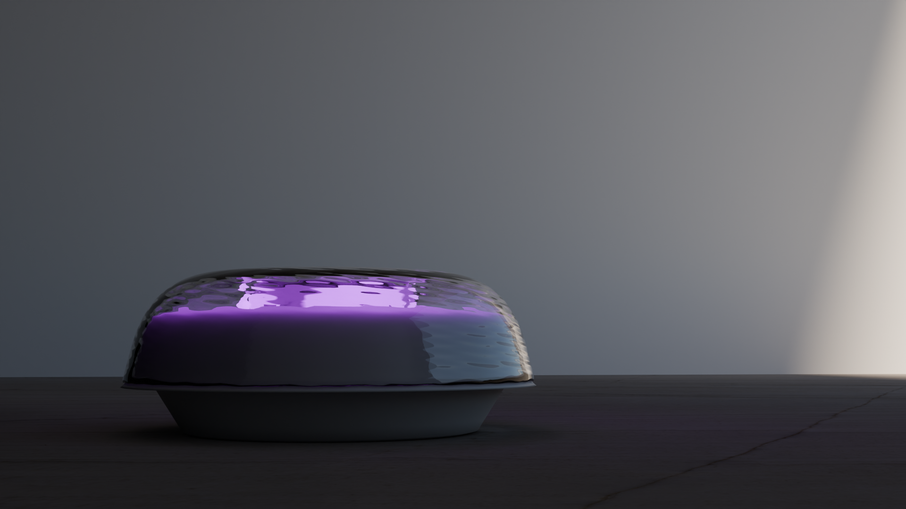

# UFI: UV Functional Identification System

## Overview

The UFI (UV Functional Identification System) is a portable optoelectronic device designed for real-time ultraviolet radiation monitoring and threshold verification. The system architecture is divided into three dedicated printed circuit boards, organizing the measurement, control, and power management domains into a stacked modular assembly.

## Hardware Architecture

The electronic hardware consists of three interconnected PCBs:

* CzujnikUV (Sensor PCB): Located at the top of the stack to ensure an unobstructed optical aperture. It acquires incident UV radiation levels and conditions the analog sensor signals for digitization.
* MAIN_PCB (Processing and Control PCB): The central compute unit responsible for sensor polling, data processing, and threshold detection. Based on instantaneous and integrated exposure data, it triggers corresponding visual and audible UV alert levels in accordance with photobiological safety standards defined by IEC 62471 and IEC 62471-6 (Risk Groups RG0 through RG3).
* Charger_PCB (Power and Charging Management PCB): Integrated power delivery board featuring a dedicated charging controller for a rechargeable lithium coin cell battery (LIR2450). It includes a standard USB-C port for field charging and power regulation.

## Key Features

* Modular three-board design: CzujnikUV, MAIN_PCB, and Charger_PCB arranged in a vertical stack.
* Standardized UV risk classification: Dynamic alarm triggering corresponding to exposure limits compliant with IEC 62471 / IEC 62471-6.
* Power supply subsystem: Onboard charging circuit for rechargeable LIR2450 coin cells via USB-C interface.
* Mechanical integration: Custom housing tailored to fit the modular electronics stack, internal interconnects, and sensor geometry.

## Prototype Validation

The physical prototype verifies the physical scale, hand-held ergonomics, and real-world form factor of the device.

  
  

## Industrial and Mechanical Design

The mechanical enclosure and visual assets were designed and developed by Aleksandra Miechowicz. The mechanical design balances compact dimensions, structural rigidity, and assembly ergonomics for the three-board stack.

Contact to Mechanical Design & 3D Visualization designer: [Aleksandra@miechowicz.pl](mailto:Aleksandra@miechowicz.pl)

## CAD Visualizations and Renderings

### Illumination Configurations and Side Profile

  
  

### Structural Breakdown and Exploded Assembly

  
  

### Isometric and Perspective Renders

  
  

## Repository Structure

* Charger_PCB: Schematic and layout files for the USB-C and LIR2450 charging subsystem.
* CzujnikUV: Top layer UV sensor PCB layout and front-end interface circuitry.
* MAIN_PCB: Central processing board, alarm circuitry, and logic control.
* First_prototype/handcomparison.jpg: Ergonomic and scale evaluation in hand.
* First_prototype/ufiprototype.jpg: Assembled hardware prototype.
* 3D_Visualization/UFIdiffrentlightsettings.png: Lighting and emission state visualization.
* 3D_Visualization/UFIleftside.png: Lateral enclosure perspective view.
* 3D_Visualization/UFIviolettransparent.png: Material transparency and optical path visualization.
* 3D_Visualization/blowupUFI.png: Exploded CAD view detailing individual assembly components.
* 3D_Visualization/ufi3.png: Perspective isometric rendering of the assembled device.
* 3D_Visualization/ufi4.png: Secondary operational rendering.

## Credits and Contact

* System architecture and electronics: Sidowsky
* Mechanical design and 3D visualization: Aleksandra Miechowicz ([Aleksandra@miechowicz.pl](mailto:Aleksandra@miechowicz.pl))
